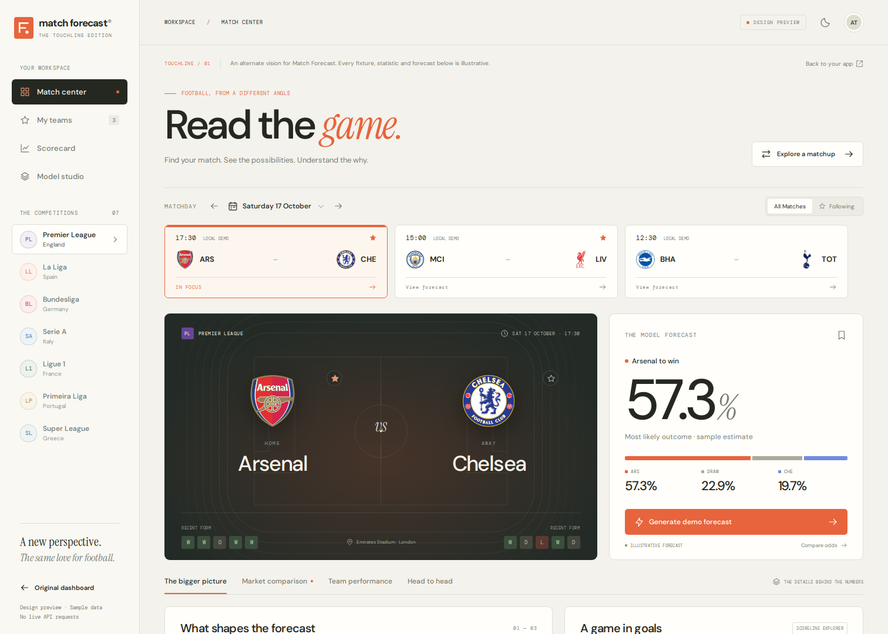

> **Archived design reference.** The concept became the live Touchline app.
> The standalone simulator and classic page have been removed; their old URLs
> now open Touchline. Instructions below describe the historical prototype.

# Touchline: alternate dashboard concept

The approved Touchline design is now the live dashboard at `/`; see
[live integration](touchline-live.md). The original dashboard remains at
`/classic`. This document describes the separate interactive design demo at
`/updated-mockup`, which retains illustrative data and makes no provider calls.

## Visual direction

Warm ivory, tangerine accents, a charcoal stadium canvas, and a blue away-outcome
accent. Large forecast figures anchor the page. DM Sans handles reading text,
DM Mono handles compact labels, and Instrument Serif supplies editorial accents.
A night theme reuses the layout with dark surfaces. The sidebar becomes a drawer
on phones, with horizontally scrollable fixtures and analysis tabs.

## Explore the concept

- **Match center:** switch among seven competitions, browse example dates and
  fixtures, generate a demo forecast, save it, and follow clubs.
- **Analysis:** overview, editable market comparison, team performance, and H2H.
- **Scorelines:** ranked example scores and a probability heatmap.
- **Explore a matchup:** choose two sample clubs, swap venues, and inspect a
  hypothetical forecast. Hypothetical matches cannot enter the scorecard.
- **My teams:** searchable club cards, follow controls, and example upcoming games.
- **Scorecard:** pending/settled filters, simulated results, calculated sample
  accuracy and log loss, forecast removal, and CSV export.
- **Model studio:** accessible methodology overview and a link to the repository.

## Data boundaries

All fixtures, ratings, statistics, H2H records, and results are illustrative.
The dates are fixed example matchdays starting 17 October 2026, not a live
schedule. There are 30 sample clubs and 23 sample fixtures across seven leagues.
The preview's deterministic independent-Poisson simulator exists only to make
the interface respond; it is not the production algorithm or benchmark evidence.
Its normalized score matrix supplies the sample 1X2 figures and scorelines.

Example decimal prices are converted to normalized implied probabilities.
The comparison shows differences in percentage points and does not change the
independent demo forecast.

The mockup imports neither the production API client nor the live dashboard.
It makes **zero backend/provider requests**. Club badges and fonts are packaged
locally. Preview favourites, forecasts, theme, and simulated results live only
in component memory and reset on reload. They do not modify the real dashboard's
browser storage. There is no account creation or authentication in this concept.

## Run locally

From the repository root:

```bash
cd web
npm install
npm run build
cd ..
uv run uvicorn football_predictor.api:app --reload
```

Open `http://localhost:8000/updated-mockup`, or click **UPDATED MOCKUP** in the
original dashboard. Opening the preview directly avoids mounting the live app.
For frontend development, `cd web && npm run dev` supports the same route.

## Implementation

- `web/src/Experience.tsx` selects and lazily loads the live dashboard, classic
  dashboard, and isolated demo with their CSS.
- `web/src/mockup/UpdatedMockup.tsx` owns the concept's UI and in-memory actions.
- `web/src/mockup/demoData.ts` contains sample data and UI-only probability logic.
- `web/src/mockup/mockup.css` contains both themes and responsive layouts.
- `web/public/mockup/` contains static club badges and locally hosted fonts.
- The original dashboard's existing Manrope and DM Mono fonts are also served
  locally, avoiding external stylesheet failure during lazy loading.

Club badges were retrieved from the public API-Sports media CDN and Goal API
media CDN (the corrected AEK Athens crest) and remain the respective clubs'
marks. Google Fonts supplies the typefaces;
their OFL notices are included beside the local font files.

## Verification

The compiled frontend passes `npm run build` and `npm run lint`. Browser checks
cover all seven leagues, fixture selection, generating/saving/removing forecasts,
market conversion, score matrix, analysis tabs, matchup validation, cancelling
league changes, favourites, scorecard settlement, methodology navigation, themes,
and mobile navigation. Tested widths: 320, 375, 390, 768, 1024, and 1512 px.

The compiled mockup produced no JavaScript errors or backend requests, loaded
all local images/fonts, and left existing favourites and scorecard storage intact.
The original route and its preview link were tested with live endpoints stubbed.

## Preview gallery



[Full daylight page](touchline-desktop.png) · [Night theme](touchline-night.png) ·
[Mobile](touchline-mobile.png) · [Market comparison](touchline-market.png) ·
[Scorecard](touchline-scorecard.png) · [Model studio](touchline-studio.png)
